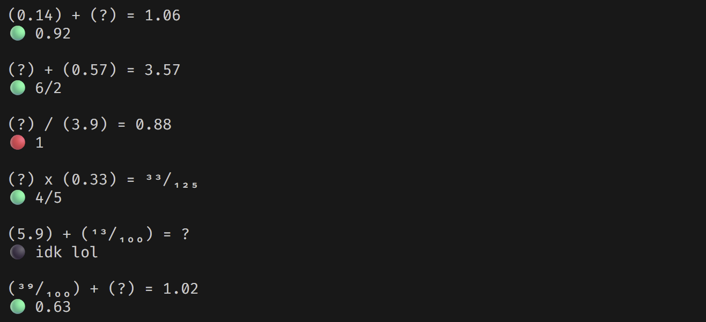

# Mental Arithmetic Trainer

 <br/>

A configurable command-line trainer for practising mental arithmetic with decimals and fractions. It generates a session of randomised problems, asks for each answer in the terminal, and prints a scored summary at the end. Inspired by [Zetamac](https://arithmetic.zetamac.com/).

## Features

- **Four operations**: addition, subtraction, multiplication and division.
- **Missing-term problems**: any of the three terms can be hidden, e.g. `(0.4) x (?) = 1.2` or `(?) + (0.35) = 0.9`.
- **Exact arithmetic**: numbers are stored as reduced fractions, so answers are checked exactly with no floating-point error.
- **Multiple display styles**: decimals, improper fractions and mixed numbers, using superscript/subscript digits (e.g. `³/₄`).
- **Flexible input**: answers can be typed as decimals (`0.75`) or fractions (`3/4`). Any other input skips the problem.
- **Live feedback**: each answer is marked 🟢 correct, 🔴 wrong or ⚫ skipped as you go.
- **Scoring and results**: configurable marks for correct, wrong and skipped answers, plus a summary at the end of the session.
- **Reproducible sessions**: an optional seed argument generates the same problem set each time.

## Dependencies

- A C++23 compiler (e.g. GCC 14+, Clang 18+ or MSVC 19.40+)
- CMake 3.20 or later
- Windows: the program uses `<windows.h>` to switch the console to UTF-8

Build from the project root:

```sh
cmake -S . -B build
cmake --build build
```

Then run the executable, optionally passing a seed (the default is `111`):

```sh
./build/mental_arithmetic 42
```

With the Visual Studio generator, the executable is in `build/Debug/` (or `build/Release/`).
